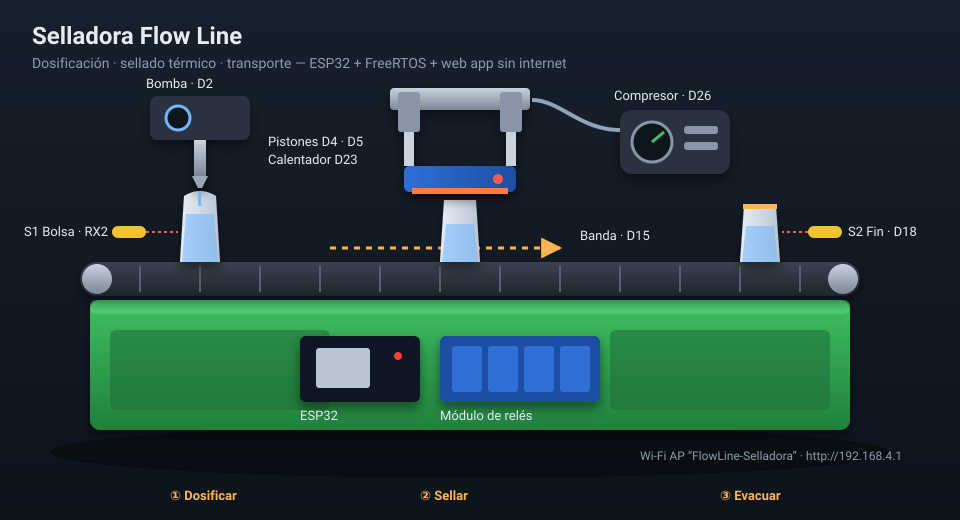
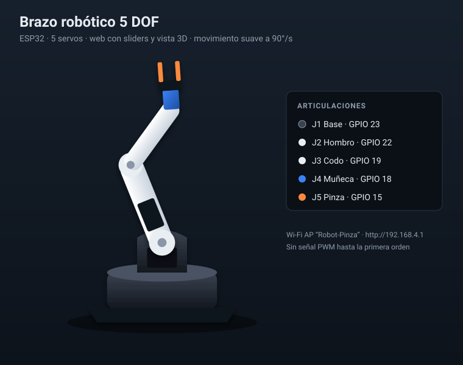

# SO_FLUIDSOLID_BANDA_SELLADO

   

Repositorio con dos proyectos independientes de ESP-IDF para ESP32:

| Proyecto | Carpeta | Descripción | Documentación |
|---|---|---|---|
| **Selladora Flow Line** | raíz (`main/`, `CMakeLists.txt`, `sdkconfig`) | Banda transportadora con dosificación, sellado por pistones, calentador y compresor, controlada con FreeRTOS y una web app sin internet. | [docs/selladora.md](docs/selladora.md) · [TABLA_VARIABLES_IO.md](TABLA_VARIABLES_IO.md) |
| **Brazo robótico 5 DOF** | [`robot_servos/`](robot_servos/) | Brazo de 5 servos con pinza, controlado desde el navegador. | [robot_servos/README.md](robot_servos/README.md) |

---

## Selladora Flow Line



Firmware para un ESP32 que automatiza una línea de llenado y sellado de bolsas: espera la bolsa, dosifica con la bomba, sella con dos pistones y la saca con la banda hasta el final de la línea. Todo se monitorea y configura desde una web servida por el propio ESP32 en su red Wi-Fi.

### Características

- **Multitarea con FreeRTOS**: tarea de seguridad (prioridad 5), tarea de proceso (3) y tarea del compresor (2), sincronizadas con un *event group* y mutex.
- **Línea de tiempo editable desde la web**: hasta 8 pasos; cada paso enciende un conjunto de salidas, puede esperar a un sensor para empezar y puede terminar al detectar un sensor. Se guarda en NVS sin reprogramar.
- **Sensores ópticos** E18-D80NK para detectar la bolsa (S1) y el fin de banda (S2).
- **Modo automático** (ciclos continuos) y **modo manual** (encender cada salida a mano).
- **Paro de emergencia enclavado** por botón físico o desde la web, con rearme.
- **Compresor protegido**: marcha máxima configurable y reposo proporcional obligatorio, porque no hay sensor de presión.
- **Diagnóstico de pines** en vivo para detectar cableado suelto o módulos mal configurados.
- **Web app offline** (HTML embebido en el firmware) en `http://192.168.4.1`, con API HTTP/JSON.

### Hardware

| Señal | Pin | Módulo |
|---|---|---|
| Banda | GPIO 15 (D15) | Relé SLA-12VDC 30 A, jumper en **H** (activo en HIGH) |
| Bomba | GPIO 2 (D2) | Relé SLA-12VDC 30 A, jumper en **H** (activo en HIGH) |
| Pistón 1 / Pistón 2 | GPIO 4 / GPIO 5 | Módulo de 4 relés optoacoplado 5 V (activo en LOW) |
| Calentador | GPIO 23 (D23) | Módulo de 4 relés optoacoplado 5 V (activo en LOW) |
| Compresor | GPIO 26 (D26) | Módulo de 4 relés optoacoplado 5 V (activo en LOW) |
| START / STOP | GPIO 19 / GPIO 17 (TX2) | Pulsadores a GND |
| Sensor bolsa S1 / fin de banda S2 | GPIO 16 (RX2) / GPIO 18 | E18-D80NK a 5 V con diodo |

Detalle completo en [TABLA_VARIABLES_IO.md](TABLA_VARIABLES_IO.md) y en la sección de cableado de [docs/selladora.md](docs/selladora.md#cableado).

---

## Brazo robótico 5 DOF

<p align="center"></p>

Proyecto ESP-IDF aparte en [`robot_servos/`](robot_servos/), para otra placa ESP32. Mueve 5 servos (base, hombro, codo, muñeca y pinza) en los GPIO 23, 22, 19, 18 y 15. El ESP32 crea la red Wi-Fi **"Robot-Pinza"** y sirve una web con un slider por articulación y una vista 3D del brazo.

Toda su documentación está en [robot_servos/README.md](robot_servos/README.md).

---

## Estructura del repositorio

```text
SO_FLUIDSOLID_BANDA_SELLADO/
├── CMakeLists.txt          # Proyecto ESP-IDF de la selladora
├── sdkconfig               # Configuración de la selladora (ESP32, flash 2 MB)
├── main/
│   ├── CMakeLists.txt      # Componente main; embebe index.html
│   ├── Kconfig.projbuild   # SSID y contraseña de la red Wi-Fi
│   ├── main.c              # Firmware de la selladora (FreeRTOS + web)
│   └── index.html          # Web app servida por el ESP32
├── docs/
│   └── selladora.md        # Documentación técnica de la selladora
├── TABLA_VARIABLES_IO.md   # Tabla de E/S, variables, constantes y tareas
├── proteus/                # Simulación en Proteus (sketch .ino, hex y librerías)
├── respaldo/               # Versiones anteriores de main.c e index.html
├── robot_servos/           # Proyecto ESP-IDF del brazo robótico 5 DOF
│   ├── CMakeLists.txt
│   ├── sdkconfig
│   ├── main/
│   │   ├── CMakeLists.txt
│   │   ├── main.c
│   │   └── index.html
│   └── README.md
└── LICENSE
```

---

## Requisitos

- [ESP-IDF](https://docs.espressif.com/projects/esp-idf/) **v6.1** instalado y con el entorno cargado (`export.sh` / `export.ps1` o la terminal *ESP-IDF*).
- Placa **ESP32** (ESP32-WROOM, tipo DevKit de 30 pines).
- Cable USB de datos y el driver del puente USB-serie de la placa (CP210x o CH340).

## Compilar y grabar

Desde la raíz del repositorio (selladora):

```bash
idf.py build
idf.py -p COMx -b 115200 flash monitor
```

Sustituye `COMx` por el puerto de la placa (en Linux/macOS, `/dev/ttyUSB0` o similar). Para salir del monitor: `Ctrl+]`.

> **Importante:** grabar a **115200 baudios**. En este banco de pruebas, a 460800 baudios la grabación falla por ruido en la línea serie.

Si el ESP32 no entra a modo de grabación: desconecta y vuelve a conectar el USB; si sigue sin responder, mantén pulsado **BOOT** y da un toque a **EN**. Si hay algo conectado a D2 (bomba), desconéctalo mientras se graba, porque D2 es pin de arranque.

Para cambiar el nombre o la contraseña de la red Wi-Fi:

```bash
idf.py menuconfig    # Flow Line - Web app
```

Para el brazo robótico, entra en la carpeta del proyecto y compila por separado:

```bash
cd robot_servos
idf.py build
idf.py -p COMx -b 115200 flash monitor
```

## Uso rápido

1. Alimenta el ESP32 y los módulos de relés (GND común).
2. Conéctate a la red Wi-Fi **`FlowLine-Selladora`** (contraseña por defecto `flowline123`).
3. Abre **http://192.168.4.1** en el navegador.
4. Pulsa **Iniciar ciclo** (o el botón START físico) o activa el **Modo automático**.

## Documentación

- [docs/selladora.md](docs/selladora.md): arquitectura, proceso, compresor, API HTTP, cableado y solución de problemas.
- [TABLA_VARIABLES_IO.md](TABLA_VARIABLES_IO.md): tablas de entradas/salidas, variables, constantes y tareas.
- [robot_servos/README.md](robot_servos/README.md): brazo robótico 5 DOF.
- [docs/diagramas.md](docs/diagramas.md): diagramas de bloques, conexiones, tareas FreeRTOS y ciclos de los dos proyectos.
- [docs/historia.md](docs/historia.md): diagrama de flujo de los prompts y decisiones que llevaron a este repositorio, con las lecciones del banco de pruebas.

## Licencia

El código de este repositorio es de **dominio público** (o con licencia **CC0**, a tu elección). Se distribuye "TAL CUAL", sin garantías ni condiciones de ningún tipo, expresas o implícitas. Consulta el archivo [LICENSE](LICENSE).
