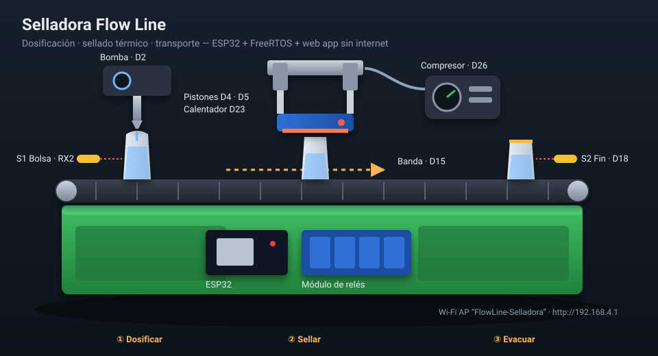
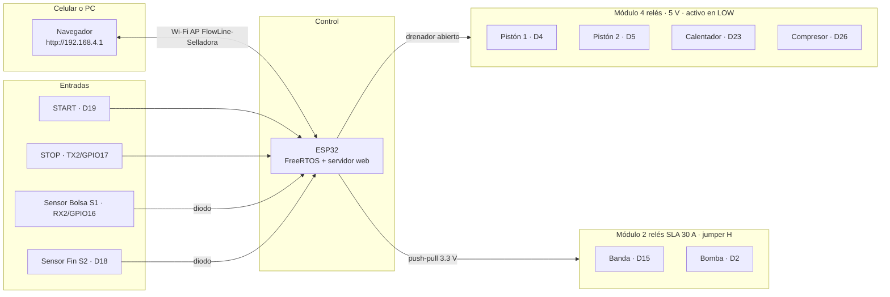
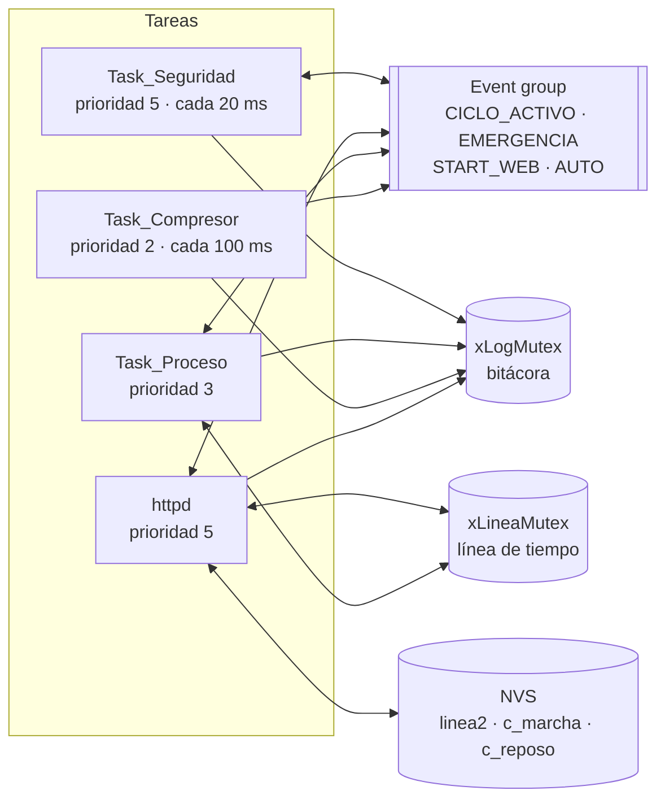
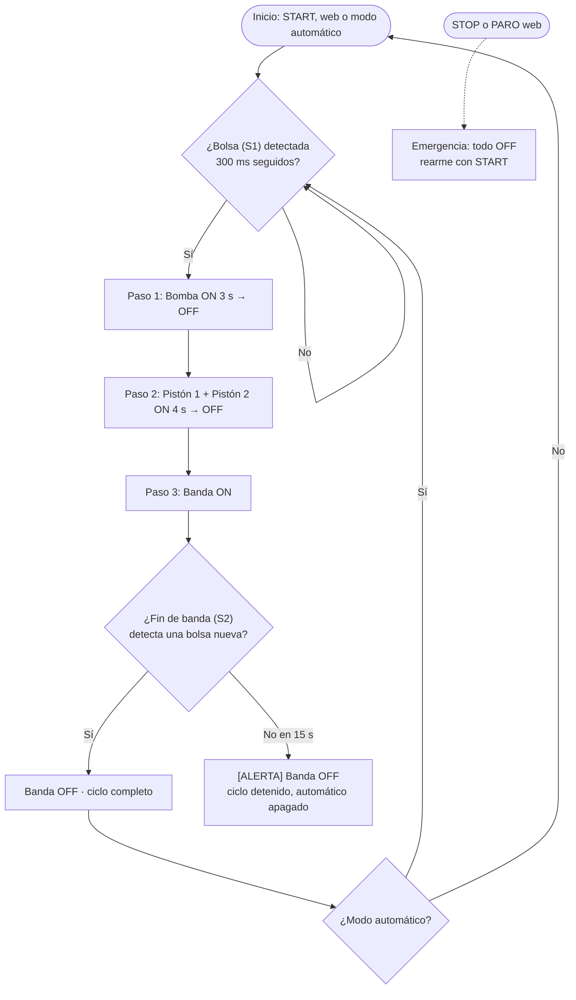
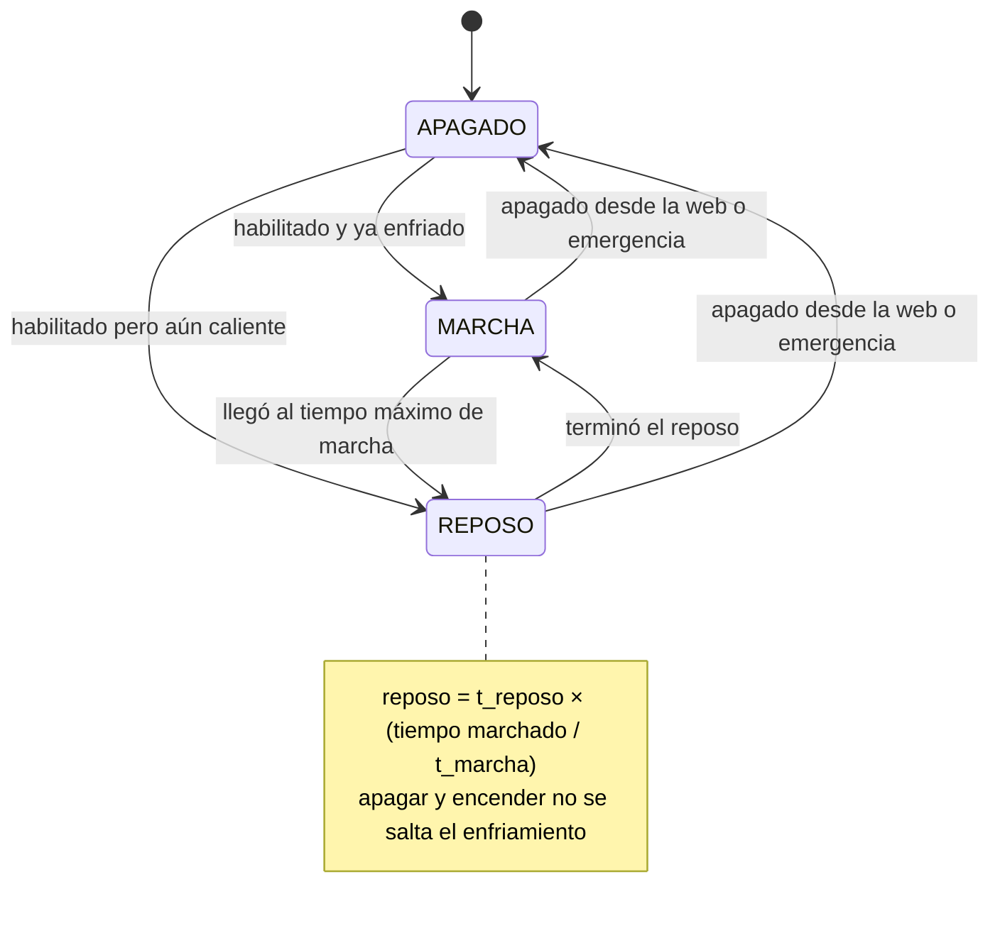
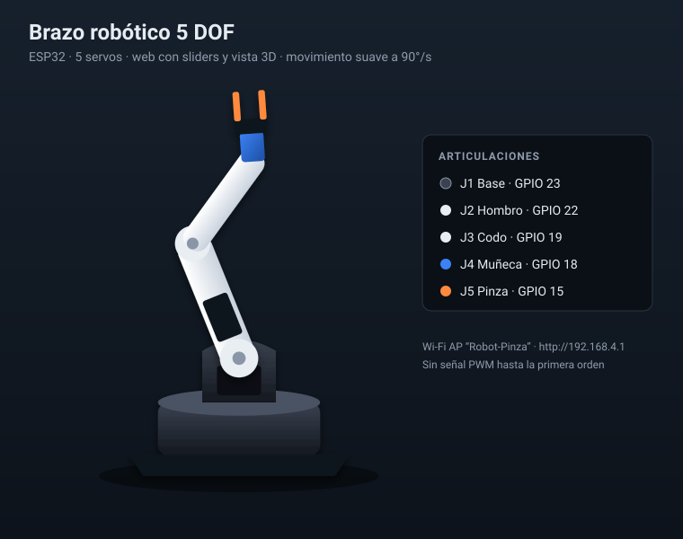
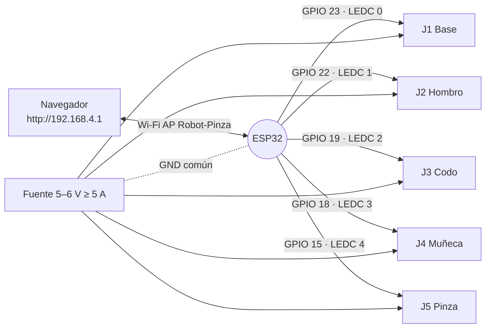
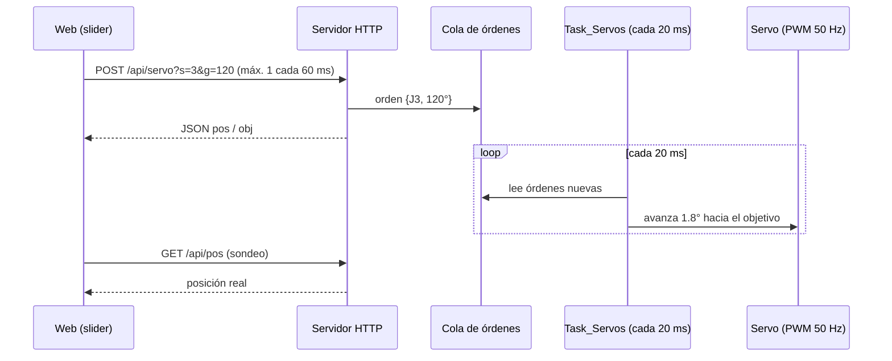
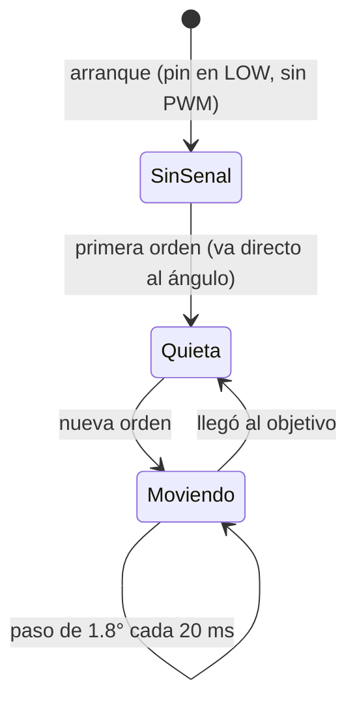

# Diagramas del sistema

Diagramas de bloques, conexiones y software de los dos proyectos del repositorio. GitHub los dibuja directamente a partir del código Mermaid.

- [Selladora Flow Line](#selladora-flow-line)
  - [Bloques de hardware](#bloques-de-hardware)
  - [Conexiones del ESP32](#conexiones-del-esp32)
  - [Tareas FreeRTOS](#tareas-freertos)
  - [Ciclo de una bolsa](#ciclo-de-una-bolsa)
  - [Compresor protegido](#compresor-protegido)
- [Brazo robótico 5 DOF](#brazo-robótico-5-dof)
  - [Bloques y conexiones](#bloques-y-conexiones)
  - [De la web al servo](#de-la-web-al-servo)
  - [Estados de una articulación](#estados-de-una-articulación)

---

## Selladora Flow Line

### Bloques de hardware

### Conexiones del ESP32

```mermaid
flowchart TB
    ESP(("ESP32"))
    ESP --- D15["D15 → IN1 módulo 2 relés → Banda"]
    ESP --- D2["D2 → IN2 módulo 2 relés → Bomba"]
    ESP --- D4["D4 → IN módulo 4 relés → Pistón 1"]
    ESP --- D5["D5 → IN módulo 4 relés → Pistón 2"]
    ESP --- D23["D23 → IN módulo 4 relés → Calentador"]
    ESP --- D26["D26 → IN módulo 4 relés → Compresor"]
    ESP --- D19["D19 ← botón START a GND"]
    ESP --- G17["GPIO17 ← botón STOP a GND"]
    ESP --- G16["GPIO16 ← diodo ← E18-D80NK Bolsa (5 V)"]
    ESP --- D18["D18 ← diodo ← E18-D80NK Fin de banda (5 V)"]
    ESP --- GND["GND común con relés, sensores y fuentes"]
```

### Tareas FreeRTOS

### Ciclo de una bolsa

El orden, los tiempos y los sensores de cada paso se cambian desde la web sin reprogramar.

### Compresor protegido

---

## Brazo robótico 5 DOF

### Bloques y conexiones

### De la web al servo

### Estados de una articulación

