# Historia del proyecto: de los prompts al repositorio

Este proyecto se construyó en una conversación con un asistente de programación (Claude Code), conectado al ESP32 por USB, del 4 al 13 de noviembre de 2026. Cada nodo resume una petición (*prompt*) y lo que se hizo con ella. Las flechas siguen el orden real; los nodos rojos son fallas del banco de pruebas que obligaron a cambiar de rumbo.

**Leyenda:** 🟦 petición · 🟩 resultado · 🟥 falla encontrada · 🟨 decisión de diseño

## Diagrama de flujo

```mermaid
flowchart TD
    classDef prompt fill:#1f3b63,stroke:#4c8dff,color:#e6ebf2
    classDef hecho fill:#163d26,stroke:#2fbf6b,color:#e6ebf2
    classDef falla fill:#4a1d1d,stroke:#ff5a52,color:#e6ebf2
    classDef decision fill:#4a3a12,stroke:#e0a020,color:#e6ebf2

    subgraph F1["1 · Selladora: primera versión"]
        P1["Transcripción de la presentación<br/>+ «web app con control y monitoreo offline<br/>y FreeRTOS como viene main, súbelo ya a ESP32»"]:::prompt
        H1["Web app embebida en el firmware<br/>AP Wi-Fi FlowLine-Selladora<br/>tareas Seguridad · Proceso · Banda"]:::hecho
        P2["«Tabla de variables y E/S<br/>y modo automático»"]:::prompt
        H2["TABLA_VARIABLES_IO.md<br/>modo automático con bit EV_AUTO"]:::hecho
        P3["«Bomba primero, apágala, los dos pistones,<br/>luego la banda… una línea de tiempo<br/>para no andar reprogramando el orden»"]:::prompt
        H3["Línea de tiempo editable desde la web<br/>pasos con máscara de salidas, guardada en NVS"]:::hecho
        P1 --> H1 --> P2 --> H2 --> P3 --> H3
    end

    subgraph F2["2 · Selladora: banco de pruebas real"]
        P4["Foto de la placa:<br/>«que sean los de la hilera de arriba»"]:::prompt
        P5["«Lógica inversa para las electroválvulas»"]:::prompt
        P6["«Dos ópticos NPN para activar la bomba»<br/>«sensor de bolsa y de fin de banda»"]:::prompt
        H6["Condición de inicio y de fin por sensor en cada paso<br/>la banda corre hasta que llega la bolsa (máx. 15 s)"]:::hecho
        E1["Un relé sin carga encendido<br/>y los pistones no conmutan"]:::falla
        D1["Módulo de 4 relés: activo en LOW<br/>y en drenador abierto"]:::decision
        E2["D21 y D22 no prenden nada"]:::falla
        H7["Diagnóstico de cableado al arrancar<br/>D21=0 D22=0: el cable no llega"]:::hecho
        E3["0.72 V en el pin: es otro módulo<br/>SLA 30 A con jumper H/L"]:::falla
        D2["Banda y bomba activas en HIGH, push-pull<br/>jumper en H · banda D15, bomba D2"]:::decision
        E4["El sensor E18 detecta siempre<br/>(alimentado a 3.3 V)"]:::falla
        D3["Sensor a 5 V con diodo hacia el pin<br/>(saca 4.8 V sin objeto)"]:::decision
        P7["«Haz una sección para debuguear las entradas»"]:::prompt
        H8["Tarjeta «Diagnóstico de pines» en vivo"]:::hecho
        P8["«Guarda como checkpoint»"]:::prompt
        H9["Repositorio git local · commit c0641bc"]:::hecho
        P4 --> P5 --> P6 --> H6 --> E1 --> D1 --> E2 --> H7 --> E3 --> D2 --> E4 --> D3 --> P7 --> H8 --> P8 --> H9
    end

    subgraph F3["3 · Brazo robótico"]
        P9["«Probar 2 SG90 en D22 y D21 con interfaz web<br/>desde USB serial con sliders»"]:::prompt
        H10["Web Serial + firmware con cola FreeRTOS"]:::hecho
        P10["«Es muñeca y pinza,<br/>si pudieras animar algo genérico en 3D»"]:::prompt
        H11["Vista 3D hecha con CSS, sin librerías"]:::hecho
        P11["«Es una ESP diferente… déjalo home<br/>e interfaz web AP»"]:::prompt
        H12["AP Wi-Fi Robot-Pinza + web servida por el ESP32"]:::hecho
        P12["«23 y 19: no quiero que se mueva<br/>hasta que se mande orden»"]:::prompt
        D4["Sin PWM al arrancar;<br/>la primera orden conecta el canal LEDC"]:::decision
        E5["El ESP no responde al grabar<br/>(cables junto a TX/RX, placa COM7 muerta)"]:::falla
        E6["«La ESP saca 3 V y el servo es de 5…»<br/>→ era la tierra"]:::falla
        P13["«Para los 5 DOF en 23, 22, 19, 18, 15»"]:::prompt
        H13["Brazo de 5 ejes con movimiento suave a 90°/s"]:::hecho
        P9 --> H10 --> P10 --> H11 --> P11 --> H12 --> P12 --> D4 --> E5 --> E6 --> P13 --> H13
    end

    subgraph F4["4 · Entrega"]
        P14["«Documentado como en GitHub, haz un repositorio,<br/>relé del compresor: sube a 1 PSI, se queda<br/>y se calienta, evita eso · usa subagentes»"]:::prompt
        D5["Sin sensor de presión: marcha máxima<br/>y reposo proporcional obligatorio"]:::decision
        H14["Task_Compresor en GPIO 26<br/>+ 2 subagentes escriben la documentación"]:::hecho
        H15["Repositorio en GitHub · commit ebf7915"]:::hecho
        P15["«Hazle un render, hazlo público,<br/>diagramas y los prompts en diagrama de flujo»"]:::prompt
        H16["Renders SVG · docs/diagramas.md<br/>· este documento · repositorio público"]:::hecho
        P14 --> D5 --> H14 --> H15 --> P15 --> H16
    end

    H3 --> P4
    H9 --> P9
    H13 --> P14
```

## Lecciones del banco de pruebas

| Problema | Causa real | Solución |
|---|---|---|
| Relé encendido sin orden | Módulo optoacoplado activo en LOW manejado como activo en HIGH | `ACTIVA_EN_BAJO` y drenador abierto |
| Relé que se queda a medias | 3.3 V no apagan del todo el opto de un módulo de 5 V | Drenador abierto: el pin flota para apagar |
| Banda y bomba no responden | Cable que no llegaba al IN y luego otro módulo (SLA 30 A, jumper H/L) | Diagnóstico de cableado; jumper en H y push-pull |
| Sensor que detecta siempre | E18-D80NK alimentado a 3.3 V | 5 V y diodo hacia el pin del ESP32 |
| Servos que no se mueven | Sin GND común entre la fuente y el ESP32 | Unir los GND |
| El ESP no se deja grabar | Cables tocando TX/RX, placa dañada, ruido a 460800 baudios | Liberar TX/RX, reconectar USB, grabar a 115200 |
| Compresor caliente | Sin sensor de presión, se quedaba en marcha a 1 PSI | Límite de marcha y reposo proporcional |
