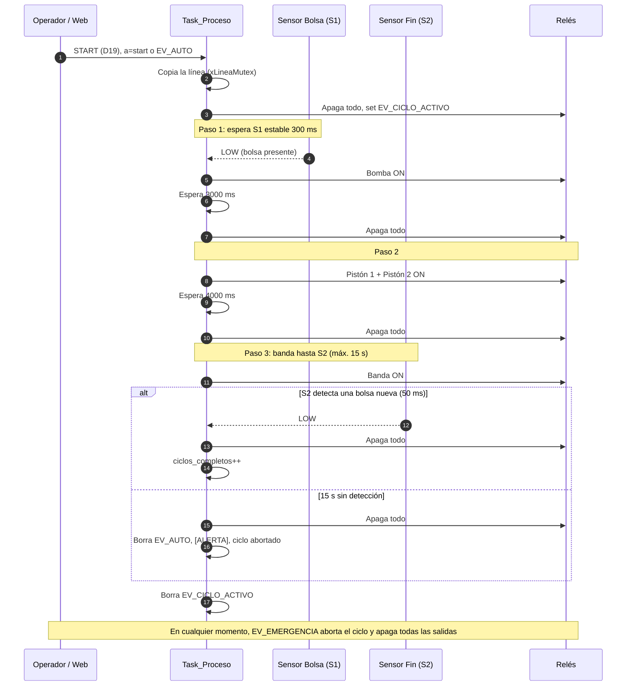
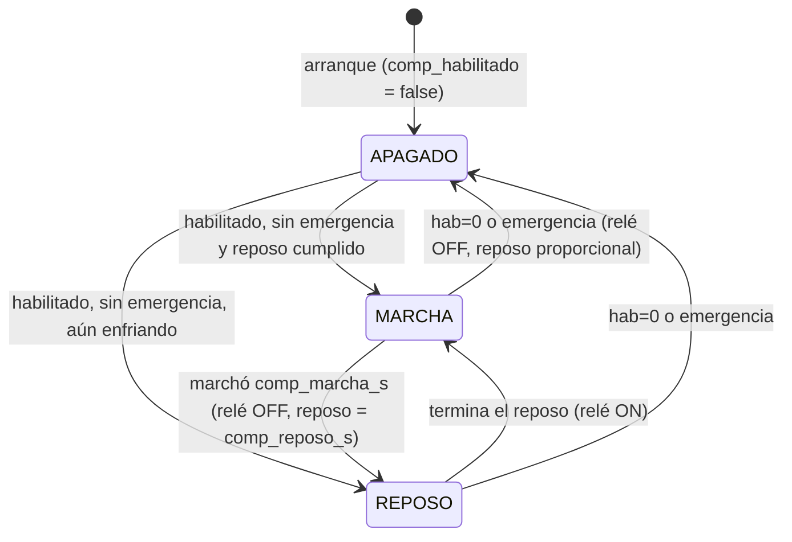

# Selladora Flow Line — Documentación técnica

  

Firmware: [`main/main.c`](../main/main.c) · Web app: [`main/index.html`](../main/index.html) · Configuración Wi-Fi: [`main/Kconfig.projbuild`](../main/Kconfig.projbuild)

Tablas de referencia rápida: [TABLA_VARIABLES_IO.md](../TABLA_VARIABLES_IO.md)

## Contenido

1. [Resumen](#resumen)
2. [Arquitectura FreeRTOS](#arquitectura-freertos)
3. [Proceso y línea de tiempo](#proceso-y-línea-de-tiempo)
4. [Modo automático](#modo-automático)
5. [Modo manual](#modo-manual)
6. [Paro de emergencia y rearme](#paro-de-emergencia-y-rearme)
7. [Compresor](#compresor)
8. [Diagnóstico de pines](#diagnóstico-de-pines)
9. [Red Wi-Fi](#red-wi-fi)
10. [Web app](#web-app)
11. [API HTTP](#api-http)
12. [Persistencia en NVS](#persistencia-en-nvs)
13. [Cableado](#cableado)
14. [Solución de problemas](#solución-de-problemas)

---

## Resumen

El ESP32 controla cinco salidas de proceso (banda, bomba, pistón 1, pistón 2 y calentador) y una sexta salida independiente para el compresor. Lee dos pulsadores (START y STOP) y dos sensores ópticos (bolsa S1 y fin de banda S2). El ciclo de trabajo es una **línea de tiempo** de pasos que se edita y guarda desde la web, sin reprogramar.

Ciclo por defecto:

1. Espera a que el sensor **Bolsa (S1)** detecte una bolsa y enciende la **bomba** 3 s (dosificación).
2. Enciende los **dos pistones** 4 s (sellado).
3. Enciende la **banda** hasta que el sensor **Fin de banda (S2)** detecta la bolsa (máximo 15 s).

Al arrancar, el firmware:

1. Pone todas las salidas en reposo antes de configurarlas, para que ningún relé pulse.
2. Configura las salidas activas en LOW en drenador abierto y las activas en HIGH en push-pull.
3. Configura el compresor (apagado) y las entradas con pull-up interno.
4. Crea el *event group* y los mutex, y registra en la bitácora el diagnóstico del módulo de 4 relés.
5. Inicializa NVS y carga la línea de tiempo y los tiempos del compresor.
6. Crea las tareas, levanta la red Wi-Fi y el servidor HTTP.

---

## Arquitectura FreeRTOS

### Tareas

| Tarea | Función | Prioridad | Pila | Periodo | Responsabilidad |
|---|---|---|---|---|---|
| `Task_Seguridad` | `vTaskSeguridad` | **5** | 3072 B | 20 ms | Lee STOP, enclava el paro, gestiona el rearme por START y refuerza el estado seguro mientras dura la emergencia. |
| `httpd` | servidor `esp_http_server` | 5 (valor por defecto de `HTTPD_DEFAULT_CONFIG`) | 6144 B | — | Sirve la web y atiende la API. `lru_purge_enable = true`. |
| `Task_Proceso` | `vTaskProceso` | **3** | 4096 B | 20 ms | Espera el inicio de ciclo y ejecuta la línea de tiempo paso por paso. |
| `Task_Compresor` | `vTaskCompresor` | **2** | 3072 B | 100 ms | Máquina de estados del compresor (apagado, marcha, reposo). |

`app_main` crea las tres tareas propias con `xTaskCreate` (sin afinidad de núcleo) y después inicia la red Wi-Fi y el servidor web.

### Event group `xEventosSistema`

| Bit | Macro | Significado | Se activa | Se borra |
|---|---|---|---|---|
| `BIT0` | `EV_CICLO_ACTIVO` | Hay un ciclo de sellado en curso | `Task_Proceso` al empezar el ciclo | `Task_Proceso` al terminar o abortar el ciclo |
| `BIT1` | `EV_EMERGENCIA` | Paro de emergencia enclavado | `activar_emergencia()` (STOP físico o `a=paro`) | Rearme: START físico con STOP liberado, o `a=rearme` |
| `BIT2` | `EV_START_WEB` | Inicio de ciclo pedido desde la web | `POST /api/cmd?a=start` | `Task_Proceso` al atenderlo; también un paro |
| `BIT3` | `EV_AUTO` | Modo automático: encadena ciclos | `POST /api/cmd?a=auto&v=1` | `a=auto&v=0`, un paro, o un paso que agota su tiempo máximo sin detección |

### Mutex

| Mutex | Protege | Quién lo usa |
|---|---|---|
| `xLineaMutex` | La línea de tiempo global `linea` | `Task_Proceso` (copia local al empezar cada ciclo), `GET /api/estado`, `POST /api/linea` |
| `xLogMutex` | La bitácora circular (`log_txt`, `log_ms`, `log_seq`) | `bitacora()` desde cualquier tarea y `GET /api/estado` (espera máxima 50 ms) |

### Bitácora

`bitacora()` escribe cada mensaje por el puerto serie (`printf`) y en un búfer circular de **24 mensajes de hasta 96 caracteres**, con la marca de tiempo en milisegundos desde el arranque. La web muestra ese búfer y resalta en rojo las líneas que contienen `ALERTA` o `abortado`.

---

## Proceso y línea de tiempo

### Estructura

```c
typedef struct {
    uint8_t  mascara;    // bit i = salida i encendida durante el paso
    uint32_t ms;         // duración del paso, o tiempo máximo si tiene condición de fin
    uint8_t  condicion;  // sensores que deben detectar antes de empezar
    uint8_t  fin;        // sensores que terminan el paso antes de ms
} paso_t;

typedef struct {
    uint8_t n;                 // 1 a 8 pasos
    paso_t  paso[MAX_PASOS];
} linea_t;
```

### Máscara de salidas

| Bit | Índice | Salida | Valor en la máscara |
|---|---|---|---|
| 0 | `S_BANDA` | Banda | 1 |
| 1 | `S_BOMBA` | Bomba | 2 |
| 2 | `S_PISTON1` | Pistón 1 | 4 |
| 3 | `S_PISTON2` | Pistón 2 | 8 |
| 4 | `S_CALENTADOR` | Calentador | 16 |

Una máscara 0 es una **pausa** (todas apagadas durante `ms`). El compresor no forma parte de la máscara: tiene su propia tarea.

### Condiciones de inicio y fin

| Valor | Macro | Inicio (`condicion`) | Fin (`fin`) |
|---|---|---|---|
| 0 | `C_NINGUNA` | Empieza de inmediato | Termina solo por tiempo |
| 1 | `C_S1` | Espera a Bolsa (S1) | Termina al detectar Bolsa (S1) |
| 2 | `C_S2` | Espera a Fin de banda (S2) | Termina al detectar Fin de banda (S2) |
| 3 | `C_AMBOS` | Espera a S1 **y** S2 | Termina cuando detectan S1 **y** S2 |
| 4 | `C_CUALQUIERA` | Espera a S1 **o** S2 | Termina cuando detecta S1 **o** S2 |

Los sensores son NPN: **LOW = objeto detectado**.

- **Inicio**: la condición debe mantenerse estable **300 ms** seguidos (`T_DETECCION_MS`), muestreando cada 20 ms. Si se interrumpe, el contador vuelve a cero. Mientras espera, todas las salidas están apagadas. Solo la cancela un paro de emergencia.
- **Fin**: basta una detección estable de **50 ms** (`T_DETECCION_FIN_MS`), pero solo cuenta una detección **nueva**: si la condición ya se cumplía al empezar el paso (por ejemplo, la bolsa anterior sigue frente a S2), primero tiene que liberarse y volver a detectar.
- Si un paso con condición de fin agota su `ms` sin detectar (atasco o bolsa caída), el ciclo se **aborta** con el motivo "tiempo maximo sin deteccion", se **apaga el modo automático** y la bitácora registra `[ALERTA] Paso N: ... no detecto en ... ms. Automatico apagado.`

### Línea de tiempo por defecto

| Paso | Empieza | Salidas | Máscara | Tiempo | Termina |
|---|---|---|---|---|---|
| 1 | Bolsa (S1) estable 300 ms | Bomba | 2 | 3000 ms | Por tiempo |
| 2 | De inmediato | Pistón 1 + Pistón 2 | 12 | 4000 ms | Por tiempo |
| 3 | De inmediato | Banda | 1 | 15000 ms máx. | Fin de banda (S2), detección nueva de 50 ms |

### Validación

Una línea es válida si tiene **1 a 8 pasos**, cada máscara es menor que 32, cada tiempo está entre **100 y 60000 ms** y cada condición está entre 0 y 4. Se valida tanto al cargarla de NVS como al recibirla por la API.

### Ejecución de un ciclo (`Task_Proceso`)

1. Pone `paso_actual = -1` y espera, sin emergencia, uno de estos disparadores:
   - el bit `EV_START_WEB` (lo consume al leerlo),
   - el bit `EV_AUTO`,
   - el botón START en LOW confirmado tras 50 ms de antirrebote. En este caso espera a que se suelte el botón para no encadenar ciclos.
2. Copia la línea global a una variable local bajo `xLineaMutex`: la web no puede cambiar la línea a mitad de un ciclo.
3. Apaga todas las salidas (descarta lo que se haya dejado en modo manual) y activa `EV_CICLO_ACTIVO`.
4. Para cada paso: espera la condición de inicio (si la hay), aplica la máscara, espera el tiempo o la condición de fin, y **apaga todas las salidas** al terminar el paso.
5. Si todo terminó bien, incrementa `ciclos_completos`; si no, registra "Ciclo abortado por emergencia" o "por tiempo maximo sin deteccion".
6. Borra `EV_CICLO_ACTIVO` y vuelve a esperar.

### Diagrama de secuencia del ciclo (línea por defecto)



---

## Modo automático

- Se activa con `POST /api/cmd?a=auto&v=1` (interruptor **Modo automático** de la web). No se puede activar con la emergencia activa.
- Con `EV_AUTO` activo, `Task_Proceso` empieza un ciclo nuevo en cuanto termina el anterior, sin pulsar START. Con la línea por defecto, cada ciclo vuelve a esperar a que S1 detecte la siguiente bolsa.
- Al desactivarlo (`v=0`), el ciclo en curso **termina normalmente** y después el sistema queda en espera.
- Se desactiva solo con un **paro de emergencia** o cuando un paso agota su tiempo máximo sin detectar. Tras el rearme hay que volver a activarlo.
- **No se guarda** en NVS: tras un reinicio o un corte de luz el sistema arranca con el automático apagado.
- Con el automático activo se bloquean el modo manual, el botón **Iniciar ciclo** y el guardado de la línea de tiempo.

## Modo manual

- Cada salida de proceso se enciende o apaga con `POST /api/cmd?a=salida&s=<nombre>&v=0|1` (interruptores de la tarjeta **Salidas (modo manual)**).
- Solo está permitido **sin emergencia, sin modo automático y sin ciclo en curso**; si no, la API responde `409`.
- Las salidas que se dejen encendidas a mano se apagan al empezar el siguiente ciclo.
- El compresor no está en esta tarjeta: tiene su propio interruptor (ver [Compresor](#compresor)).

---

## Paro de emergencia y rearme

### Activación

El paro se activa al pulsar **STOP** (GPIO 17 en LOW) o con `POST /api/cmd?a=paro`. `activar_emergencia()`:

1. Activa `EV_EMERGENCIA`.
2. Borra `EV_START_WEB` y `EV_AUTO` (cancela el modo automático).
3. Apaga las cinco salidas de proceso.
4. Apaga el relé del compresor y deshabilita el compresor (`comp_habilitado = false`).
5. Registra `[ALERTA CRITICA] PARO DE EMERGENCIA ACTIVADO (boton STOP | web)!`.

Mientras dura la emergencia, `Task_Seguridad` vuelve a apagar todas las salidas cada 20 ms. Las esperas de `Task_Proceso` revisan el bit cada 20 ms y abortan el ciclo. El paro queda **enclavado**: soltar STOP no lo borra.

### Rearme

| Origen | Requisito | Efecto |
|---|---|---|
| Botón START físico | STOP liberado (GPIO 17 en HIGH) | `Task_Seguridad` espera a que se suelte START, borra `EV_EMERGENCIA` y registra "Sistema rearmado". Ese toque de START **no** inicia un ciclo. |
| `POST /api/cmd?a=rearme` | STOP físico liberado | Borra `EV_EMERGENCIA`. Si STOP sigue presionado responde `409` "Libere el boton STOP fisico". |

Después del rearme el automático y el compresor siguen apagados: hay que volver a activarlos.

---

## Compresor

El compresor está conectado al **relé del módulo de 4 canales en GPIO 26 (D26)**, activo en **LOW**, en drenador abierto (`rele_compresor(true)` pone el pin en 0; `false` lo deja flotante). Como **no hay sensor de presión**, el compresor seguiría en marcha aunque la presión ya no suba y se calentaría; por eso el firmware limita la marcha continua y obliga a un descanso.

### Funcionamiento

- `comp_habilitado` es el interruptor de la web. **No se guarda**: al arrancar el ESP32 el compresor queda apagado.
- Fases: `APAGADO`, `MARCHA`, `REPOSO`. `Task_Compresor` las evalúa cada 100 ms.
- **Marcha**: dura como máximo `comp_marcha_s` segundos; al cumplirse se detiene y pasa a reposo.
- **Reposo proporcional**: al detenerse por cualquier motivo, el enfriamiento es proporcional a lo que marchó:

  ```text
  reposo_ms = comp_reposo_s × 1000 × marchó_ms / (comp_marcha_s × 1000)
  ```

  Por ejemplo, con los valores por defecto (60 s / 120 s), si marchó 30 s descansa 60 s. Así, apagarlo y volverlo a encender desde la web **no se salta el enfriamiento**: si está habilitado pero aún enfriándose, queda en `REPOSO` y arranca cuando termina.
- Un paro de emergencia apaga el relé y deshabilita el compresor; la tarea registra el reposo correspondiente en su siguiente paso.
- Si se cambian los tiempos durante un reposo, el fin del reposo en curso no se recalcula; los tiempos nuevos se aplican desde la siguiente marcha.

### Tiempos y rangos

| Parámetro | Variable | Por defecto | Mínimo | Máximo | Clave NVS |
|---|---|---|---|---|---|
| Marcha máxima continua | `comp_marcha_s` | 60 s | 5 s | 600 s | `c_marcha` (u32) |
| Reposo tras una marcha completa | `comp_reposo_s` | 120 s | 10 s | 3600 s | `c_reposo` (u32) |

Los valores de NVS fuera de rango se ignoran y se usan los de por defecto.

### Diagrama del ciclo del compresor



---

## Diagnóstico de pines

Todas las salidas se configuran en modo de entrada/salida (`GPIO_MODE_INPUT_OUTPUT_OD` o `GPIO_MODE_INPUT_OUTPUT`), así que el ESP32 puede **leer el nivel real** de cada pin de salida.

- **Al arrancar**, `diagnostico_salidas()` registra en la bitácora el nivel de D4, D5 y D23 (salidas activas en LOW): `[DIAG] IN modulo 4 reles (1=conectado): D4=1 D5=1 D23=1`. Con el relé apagado el pin queda flotante y el IN del módulo lo jala hacia VCC a través del LED del optoacoplador, así que se lee 1 si el módulo está conectado y alimentado; sin cable normalmente se lee 0. D26 (compresor) no aparece en este mensaje, pero sí en la tabla de la web. Las salidas activas en HIGH son push-pull y no permiten detectar el cable.
- **En la web**, la tarjeta **Diagnóstico de pines** muestra para cada señal el tipo, el comando, el nivel leído y una interpretación:

| Tipo de salida | Comando | Nivel leído | Interpretación |
|---|---|---|---|
| Activa en LOW | ON | 0 | OK: LOW, relé activado |
| Activa en LOW | ON | 1 | No baja a LOW |
| Activa en LOW | OFF | 1 | OK: módulo conectado |
| Activa en LOW | OFF | 0 | Sin módulo o sin VCC en el IN |
| Activa en HIGH | ON | 1 | OK: 3.3 V, relé activado |
| Activa en HIGH | ON | 0 | No sube: algo jala el pin a GND |
| Activa en HIGH | OFF | 0 | OK: 0 V, relé apagado |
| Activa en HIGH | OFF | 1 | Alto estando apagado |

En las entradas (pull-up) se muestra **0 = Activo** (botón presionado o sensor detectando) y **1 = Reposo**. Para el compresor, el comando se considera ON cuando la fase es `MARCHA`.

---

## Red Wi-Fi

El ESP32 funciona como **punto de acceso** (modo AP, sin internet). Los valores se configuran en [`main/Kconfig.projbuild`](../main/Kconfig.projbuild) (menú **Flow Line - Web app** de `idf.py menuconfig`):

| Parámetro | Opción Kconfig | Valor por defecto |
|---|---|---|
| SSID | `CONFIG_FLOWLINE_AP_SSID` | `FlowLine-Selladora` |
| Contraseña | `CONFIG_FLOWLINE_AP_PASSWORD` | `flowline123` |
| Seguridad | — | WPA2-PSK; **abierta** si la contraseña tiene menos de 8 caracteres |
| Canal | — | 1 |
| Clientes máximos | — | 4 |
| Dirección de la web | — | `http://192.168.4.1` |

---

## Web app

La página `main/index.html` se **embebe en el firmware** (`EMBED_TXTFILES` en `main/CMakeLists.txt`) y se sirve en `/`. No usa recursos externos, así que funciona sin internet. Consulta `GET /api/estado` cada **500 ms**; si fallan más de dos consultas seguidas muestra "Sin conexión".

| Tarjeta | Contenido |
|---|---|
| Línea de tiempo del ciclo | Diagrama de Gantt (una fila por salida, ancho de cada paso proporcional a su tiempo) con cursor rojo del paso en curso. ◉ marca pasos con condición de inicio; ≤ y ◎, pasos con condición de fin. |
| Proceso | Ciclos completos, tiempo encendido, ciclo en curso, clientes Wi-Fi y LED de START, STOP, S1 y S2. |
| Control | Botones **Iniciar ciclo**, **PARO** y **Rearme**, e interruptor de **Modo automático**. |
| Compresor | Interruptor, fase y segundos restantes, marcha máxima y reposo editables. |
| Salidas (modo manual) | Un interruptor por salida de proceso. |
| Editar orden y tiempos | Editor de pasos: salidas, tiempo, "Empieza", "Termina", subir, bajar, quitar, agregar (máx. 8), descartar y guardar. |
| Diagnóstico de pines | Tabla descrita en [Diagnóstico de pines](#diagnóstico-de-pines). |
| Bitácora | Los últimos 24 mensajes. |

Con la emergencia activa aparece un aviso rojo en la parte superior.

---

## API HTTP

Todas las respuestas de comandos tienen la forma:

```json
{"ok": true, "msg": "Texto"}
```

Si `ok` es `false`, el código HTTP es **`409 Conflict`**. Los parámetros van en la *query string*, también en las peticiones `POST` (sin cuerpo).

### Rutas

| Método | Ruta | Descripción |
|---|---|---|
| `GET` | `/` | Web app (`text/html; charset=utf-8`) |
| `GET` | `/api/estado` | Estado completo en JSON (`Cache-Control: no-store`) |
| `POST` | `/api/cmd` | Comandos de operación |
| `POST` | `/api/linea` | Guarda la línea de tiempo |
| `POST` | `/api/comp` | Habilita el compresor o cambia sus tiempos |

### `POST /api/cmd`

| Parámetros | Acción | Rechazo (`409`) |
|---|---|---|
| `a=start` | Pide un ciclo (`EV_START_WEB`) | Emergencia activa; ya hay un ciclo en curso |
| `a=paro` | Activa el paro de emergencia | — |
| `a=rearme` | Borra la emergencia ("No hay emergencia" si no había) | STOP físico presionado |
| `a=auto&v=1` | Activa el modo automático | Emergencia activa |
| `a=auto&v=0` | Desactiva el modo automático (termina el ciclo en curso) | — |
| `a=salida&s=<nombre>&v=0\|1` | Modo manual; `<nombre>` = `banda`, `bomba`, `piston1`, `piston2` o `calentador` | Emergencia, automático activo, ciclo en curso, salida desconocida |

Cualquier otro valor de `a` responde `409` "Accion desconocida".

```bash
curl -X POST "http://192.168.4.1/api/cmd?a=start"
curl -X POST "http://192.168.4.1/api/cmd?a=salida&s=bomba&v=1"
```

### `POST /api/linea`

```text
POST /api/linea?p=<mascara>.<ms>.<condicion>.<fin>_<mascara>.<ms>.<condicion>.<fin>_...
```

Los pasos van en orden, separados por `_`; los cuatro campos de cada paso, por `.`. Ejemplo con la línea por defecto:

```bash
curl -X POST "http://192.168.4.1/api/linea?p=2.3000.1.0_12.4000.0.0_1.15000.0.2"
```

Se rechaza con `409` si hay un ciclo en curso o el automático está activo, si falta `p`, si el formato es inválido, si hay más de 8 pasos o si algún valor está fuera de rango. Si es válida, reemplaza la línea (bajo `xLineaMutex`) y la guarda en NVS (`linea2`). La *query string* admite hasta 200 caracteres y `p` hasta 180, suficiente para 8 pasos.

### `POST /api/comp`

| Parámetros | Acción | Rechazo (`409`) |
|---|---|---|
| `marcha=<s>` | Marcha máxima (5–600 s) | Fuera de rango |
| `reposo=<s>` | Reposo (10–3600 s) | Fuera de rango |
| `hab=1` | Habilita el compresor | Emergencia activa |
| `hab=0` | Deshabilita el compresor | — |

Se pueden combinar. Si llega `marcha` o `reposo` válido, los tiempos se guardan en NVS antes de procesar `hab`. Respuestas: "Compresor habilitado", "Compresor apagado", "Tiempos guardados" o "Sin cambios".

```bash
curl -X POST "http://192.168.4.1/api/comp?marcha=90&reposo=180"
curl -X POST "http://192.168.4.1/api/comp?hab=1"
```

### `GET /api/estado`

Ejemplo de respuesta (formateada; el ESP32 la envía en una sola línea):

```json
{
  "paso": 2, "pasoMs": 1840, "esperando": 0,
  "ciclo": 1, "emergencia": 0, "auto": 1,
  "stop": 0, "start": 0, "s1": 0, "s2": 0,
  "ciclos": 12, "uptime": 734512, "clientes": 1,
  "salidas": {"banda": 1, "bomba": 0, "piston1": 0, "piston2": 0, "calentador": 0},
  "pinOut": [[1,0],[0,0],[1,1],[1,1],[1,1]],
  "pinIn": {"start": 1, "stop": 1, "s1": 1, "s2": 1},
  "comp": {"hab": 1, "fase": "REPOSO", "restante": 41, "marcha": 60, "reposo": 120, "nivel": 1},
  "linea": [[2,3000,1,0],[12,4000,0,0],[1,15000,0,2]],
  "logSeq": 57,
  "log": [[733900, "[PROCESO] Paso 3/3: banda ON hasta FIN DE BANDA (max 15000 ms)"]]
}
```

| Campo | Tipo | Descripción |
|---|---|---|
| `paso` | int | Índice del paso en curso (desde 0); `-1` = en espera |
| `pasoMs` | ms | Tiempo transcurrido en el paso; 0 si está en espera o esperando sensores |
| `esperando` | 0/1 | El paso actual espera su condición de inicio |
| `ciclo` | 0/1 | `EV_CICLO_ACTIVO` |
| `emergencia` | 0/1 | `EV_EMERGENCIA` |
| `auto` | 0/1 | `EV_AUTO` |
| `stop`, `start` | 0/1 | 1 = botón presionado (pin en LOW) |
| `s1`, `s2` | 0/1 | 1 = sensor detectando (pin en LOW) |
| `ciclos` | int | Ciclos completos desde el arranque |
| `uptime` | ms | Tiempo desde el arranque |
| `clientes` | int | Estaciones conectadas al AP |
| `salidas` | objeto | Estado lógico de cada salida (1 = activada), no el nivel del pin |
| `pinOut` | `[[nivel, activaEnBajo], ...]` | Nivel real leído en cada pin de salida, en el orden banda, bomba, piston1, piston2, calentador |
| `pinIn` | objeto | Nivel crudo de cada entrada (0 = activa) |
| `comp.hab` | 0/1 | Compresor habilitado |
| `comp.fase` | texto | `APAGADO`, `MARCHA` o `REPOSO` |
| `comp.restante` | s | Segundos para terminar la marcha o el reposo |
| `comp.marcha`, `comp.reposo` | s | Tiempos configurados |
| `comp.nivel` | 0/1 | Nivel real de GPIO 26 (0 = relé activado) |
| `linea` | `[[mascara, ms, condicion, fin], ...]` | Línea de tiempo guardada |
| `logSeq` | int | Total de mensajes escritos en la bitácora |
| `log` | `[[ms, "texto"], ...]` | Hasta 24 mensajes, del más antiguo al más reciente |

---

## Persistencia en NVS

Espacio de nombres **`flowline`**:

| Clave | Tipo | Contenido | Se escribe en |
|---|---|---|---|
| `linea2` | blob (`linea_t`) | Línea de tiempo | `POST /api/linea` |
| `c_marcha` | u32 | Marcha máxima del compresor (s) | `POST /api/comp` con tiempos |
| `c_reposo` | u32 | Reposo del compresor (s) | `POST /api/comp` con tiempos |

- La clave `linea2` tiene el formato con condición de fin. Un blob antiguo `linea` (otro formato) se ignora.
- Si el blob no tiene el tamaño esperado o no pasa la validación, se usa la línea por defecto.
- Si la partición NVS no tiene páginas libres o cambió de versión, se borra y se vuelve a inicializar.
- **No se guardan**: el modo automático, la habilitación del compresor, las salidas manuales ni el contador de ciclos.

---

## Cableado

### Salidas

| Salida | Pin | Módulo | Nivel activo | Modo GPIO |
|---|---|---|---|---|
| Banda | GPIO 15 (D15) | 2 relés SLA-12VDC 30 A, jumper **H** | HIGH | `GPIO_MODE_INPUT_OUTPUT` (push-pull) |
| Bomba | GPIO 2 (D2) | 2 relés SLA-12VDC 30 A, jumper **H** | HIGH | `GPIO_MODE_INPUT_OUTPUT` (push-pull) |
| Pistón 1 | GPIO 4 (D4) | 4 relés optoacoplado 5 V | LOW | `GPIO_MODE_INPUT_OUTPUT_OD` (drenador abierto) |
| Pistón 2 | GPIO 5 (D5) | 4 relés optoacoplado 5 V | LOW | `GPIO_MODE_INPUT_OUTPUT_OD` (drenador abierto) |
| Calentador | GPIO 23 (D23) | 4 relés optoacoplado 5 V | LOW | `GPIO_MODE_INPUT_OUTPUT_OD` (drenador abierto) |
| Compresor | GPIO 26 (D26) | 4 relés optoacoplado 5 V | LOW | `GPIO_MODE_INPUT_OUTPUT_OD` (drenador abierto) |

**Módulo de 4 relés optoacoplado (pistones, calentador y compresor).** Se activa con LOW. Por eso estos pines se manejan en **drenador abierto**: relé activado = pin en LOW; relé apagado = pin flotante. Con 3.3 V en push-pull el optoacoplador del módulo de 5 V no se apaga del todo. Conecta **VCC y JD-VCC a 5 V** y **GND común** con el ESP32.

**Módulo de 2 relés SLA-12VDC de 30 A (banda y bomba).** Tiene un jumper **H/L** que debe ir en **H** (activo en HIGH). En **L** funciona al revés, a medias, y puede meter corriente de 12 V al pin del ESP32.

### Entradas

| Entrada | Pin | Dispositivo | Configuración |
|---|---|---|---|
| START | GPIO 19 (D19) | Pulsador a GND | Pull-up interno, activo en LOW |
| STOP | GPIO 17 (TX2) | Pulsador a GND | Pull-up interno, activo en LOW |
| Bolsa (S1) | GPIO 16 (RX2) | E18-D80NK (NPN) | Pull-up interno, LOW = detecta |
| Fin de banda (S2) | GPIO 18 (D18) | E18-D80NK (NPN) | Pull-up interno, LOW = detecta |

**Sensores E18-D80NK.** Necesitan **5 V** (a 3.3 V detectan siempre). Su salida sube a unos **4.8 V sin objeto**, así que la señal va al ESP32 a través de un **diodo** con la **raya hacia el sensor** (cátodo en el cable de señal del sensor, ánodo en el GPIO). Así el sensor solo puede bajar el pin a LOW, y el pull-up interno lo mantiene en 3.3 V sin objeto. Un diodo **Schottky** es ideal por su baja caída de tensión. El alcance se ajusta con el **tornillo trasero** del sensor.

```text
 E18-D80NK                      ESP32
 café  ──────────────── 5 V
 azul  ──────────────── GND (común)
 negro ───|<───────────  GPIO 16 (S1) / GPIO 18 (S2)
        (raya hacia el sensor)
```

**Botones.** START y STOP cierran a **GND** (no a 3V3); el pull-up interno da el nivel HIGH en reposo.

### Pines que no se deben usar

| Pin | Motivo |
|---|---|
| TX0 / RX0 (GPIO 1 / 3) | Puerto serie del USB (grabación y monitor) |
| D0, D1, CLK, SD, CMD (GPIO 6–11) | Conectados a la memoria flash interna |
| D2 (GPIO 2) | Pin de arranque: se usa para la bomba, pero hay que desconectarlo si la placa no entra a modo de grabación |

### Alimentación y tierra

El **GND común** entre el ESP32 y las fuentes de los relés (y de los servos, si comparten banco) es **indispensable**. Sin él los niveles de las entradas y salidas no tienen referencia y los relés y sensores se comportan de forma errática.

---

## Solución de problemas

| Síntoma | Causa probable | Solución |
|---|---|---|
| Un pistón, el calentador o el compresor no se apagan del todo | Pin en push-pull a 3.3 V con el módulo optoacoplado de 5 V | El firmware ya usa drenador abierto; verifica que VCC y JD-VCC estén a 5 V y el GND sea común |
| Diagnóstico: "Sin módulo o sin VCC en el IN" en D4, D5, D23 o D26 | Cable suelto o módulo de 4 relés sin alimentar | Revisa el cable IN y la alimentación de 5 V del módulo |
| Banda o bomba funcionan al revés o a medias | Jumper H/L del módulo SLA en **L** | Pon el jumper en **H** (puede meter 12 V al pin en L) |
| Diagnóstico: "No sube: algo jala el pin a GND" en banda o bomba | Entrada del módulo cargando el pin, jumper en L o corto | Revisa el jumper y el cableado |
| S1 o S2 detectan todo el tiempo | Sensor alimentado a 3.3 V, o alcance demasiado largo | Alimenta a 5 V y ajusta el tornillo trasero |
| S1 o S2 nunca detectan | Diodo al revés o sin GND común | Raya del diodo hacia el sensor; une los GND |
| La banda corre 15 s y el ciclo se aborta con `[ALERTA]` | S2 no detectó una bolsa nueva a tiempo | Revisa S2, su alcance y que la bolsa anterior haya salido; aumenta el tiempo máximo del paso |
| El ciclo no arranca con START | Emergencia activa, ciclo en curso, o el paso 1 espera a S1 | Rearma; revisa en la web si el paso dice "esperando sensor" |
| No se puede guardar la línea o usar el modo manual | Automático activo o ciclo en curso | Apaga el automático y espera a que termine el ciclo |
| El compresor está habilitado pero no arranca | Está en reposo (enfriándose) | Espera el tiempo que muestra la web |
| La grabación falla a mitad | Ruido en la línea serie a alta velocidad | Graba a **115200 baudios** (`-b 115200`) |
| El ESP no responde al grabar | No entró a modo de descarga | Desconecta y reconecta el USB; mantén **BOOT** y da un toque a **EN**; desconecta D2 |
| No aparece la red `FlowLine-Selladora` | El firmware no arrancó o se cambió el SSID | Revisa el monitor serie (`[WIFI] Red ... activa`) y `menuconfig` |
