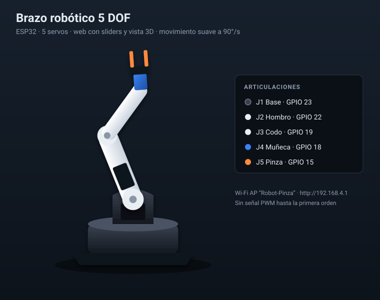
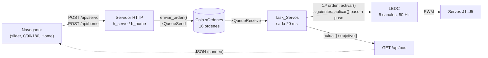

# Brazo robótico de 5 grados de libertad con ESP32

<p align="center"></p>

Brazo de **5 grados de libertad (5 DOF)** impreso en 3D y movido por servomotores, controlado por un **ESP32** desde una página web que sirve el propio ESP32 en su red Wi-Fi. No hace falta internet ni instalar ninguna app: te conectas a la red del robot, abres el navegador y mueves cada articulación.

- **Base, hombro y codo:** servos grandes tipo **MG996R**.
- **Muñeca y pinza:** micro servos **SG90**.
- **Placa:** ESP32-32U de 38 pines (chip **ESP32-D0WD-V3**).
- **Firmware:** ESP-IDF 6.1 + FreeRTOS, en C (`main/main.c`).
- **Interfaz:** una sola página HTML/CSS/JS incrustada en el firmware (`main/index.html`).

---

## Contenido

- [Características](#características)
- [Articulaciones](#articulaciones)
- [Comportamiento de seguridad](#comportamiento-de-seguridad)
- [Arquitectura FreeRTOS](#arquitectura-freertos)
- [Señal PWM](#señal-pwm)
- [API HTTP](#api-http)
- [Compilar y grabar](#compilar-y-grabar)
- [Cableado y alimentación](#cableado-y-alimentación)
- [Cómo ajustar](#cómo-ajustar)
- [Solución de problemas](#solución-de-problemas)
- [Primera prueba recomendada](#primera-prueba-recomendada)

---

## Características

- **Red Wi-Fi propia (modo AP).** El ESP32 crea la red:
  | Parámetro  | Valor          |
  |------------|----------------|
  | SSID       | `Robot-Pinza`  |
  | Contraseña | `robot1234` (WPA2-PSK) |
  | Canal      | 6              |
  | Clientes   | máximo 4       |
  | Dirección  | `http://192.168.4.1` |

  Si la contraseña tiene menos de 8 caracteres (o se deja vacía), la red se crea **abierta**.
- **Web responsive** (se adapta al celular y a la computadora) con una tarjeta por articulación:
  - un **slider** de 0 a 180°;
  - botones rápidos **0°**, **90°** y **180°**;
  - el ángulo pedido y, mientras se mueve, la posición real (“moviéndose · 47°”); antes de la primera orden muestra “sin orden”.
- **Botón Home** que lleva todas las articulaciones a su posición de reposo.
- **Vista 3D** del brazo hecha solo con transformaciones CSS (sin librerías, funciona sin internet). Se gira arrastrando con el dedo o el ratón.
- **Envío limitado:** al arrastrar un slider la web manda como máximo una orden cada 60 ms, siempre con el último valor.
- **Sondeo del estado** con `GET /api/pos`: cada 1 s normalmente y cada 200 ms mientras alguna articulación se está moviendo. El indicador de la cabecera muestra “En línea” o “Sin conexión” (tras dos fallos seguidos).

## Articulaciones

| Articulación | Nombre  | GPIO (serigrafía) | Canal LEDC       | Home | Servo  |
|--------------|---------|-------------------|------------------|------|--------|
| J1           | Base    | GPIO 23 (`D23`)   | `LEDC_CHANNEL_0` | 90°  | MG996R |
| J2           | Hombro  | GPIO 22 (`D22`)   | `LEDC_CHANNEL_1` | 90°  | MG996R |
| J3           | Codo    | GPIO 19 (`D19`)   | `LEDC_CHANNEL_2` | 90°  | MG996R |
| J4           | Muñeca  | GPIO 18 (`D18`)   | `LEDC_CHANNEL_3` | 90°  | SG90   |
| J5           | Pinza   | GPIO 15 (`D15`)   | `LEDC_CHANNEL_4` | 90°  | SG90   |

Los cinco canales comparten el temporizador `LEDC_TIMER_0` en `LEDC_LOW_SPEED_MODE`. En la web la pinza se etiqueta como “0° cerrada” y “180° abierta”.

## Comportamiento de seguridad

1. **Al arrancar no sale PWM.** En `app_main()` los cinco pines se configuran como salida y se ponen en **LOW**. El temporizador LEDC se prepara, pero ningún canal se conecta a su pin todavía. Sin pulsos, cada servo se queda suelto **donde está** hasta que recibe su primera orden. El arranque **no** manda el brazo a Home.
2. **La primera orden va directo al ángulo.** El firmware no sabe dónde está físicamente el servo, así que no hay desde dónde suavizar: `activar()` conecta el canal LEDC al pin ya con el duty del ángulo pedido.
3. **Las siguientes órdenes se mueven suave.** La tarea de servos acerca la posición `actual` al `objetivo` con pasos limitados:

   | Constante        | Valor | Significado |
   |------------------|-------|-------------|
   | `PERIODO_MOV_MS` | 20    | Un paso cada 20 ms, uno por cada pulso del servo (50 Hz). |
   | `VEL_GRADOS_S`   | 90    | Velocidad máxima de cada articulación, en grados por segundo. |
   | `PASO_DECIMAS`   | `VEL_GRADOS_S * PERIODO_MOV_MS / 100` = **18** | Paso máximo en décimas de grado: 1.8° cada 20 ms = 90°/s. |

   Las posiciones se guardan internamente en **décimas de grado** (0 a 1800) para que el paso sea fino. Un recorrido completo de 0° a 180° tarda unos 2 s.

**¿Por qué?** Un salto brusco de un servo grande golpea la estructura impresa y, sobre todo, provoca un **pico de corriente** que puede hacer caer el voltaje y **reiniciar el ESP32**. Limitar la velocidad reparte ese esfuerzo en el tiempo.

> [!NOTE]
> Si pulsas **Home** sobre una articulación que todavía no ha recibido ninguna orden, esa articulación también va **directo** a 90° (es su primera orden). Ver [Primera prueba recomendada](#primera-prueba-recomendada).

## Arquitectura FreeRTOS

| Elemento | Detalle |
|----------|---------|
| `Task_Servos` (`vTaskServos`) | Prioridad 4, pila de 3072 bytes. Cada 20 ms (`vTaskDelayUntil`) vacía la cola de órdenes, actualiza los objetivos y avanza cada articulación un paso. |
| Cola `xOrdenes` | 16 elementos de tipo `orden_t { uint8_t servo; uint8_t grados; }`. El servidor web espera hasta 50 ms para encolar; si no cabe responde “Cola llena”. |
| Servidor HTTP (`esp_http_server`) | Atiende la página y la API en su propia tarea. Solo encola órdenes y lee `actual[]` / `objetivo[]`; nunca toca el LEDC directamente. |
| Wi-Fi AP | Se inicia después de la tarea de servos, tras inicializar NVS (necesario para el Wi-Fi). |



## Señal PWM

| Parámetro   | Valor |
|-------------|-------|
| Frecuencia  | 50 Hz (periodo de 20 000 µs) |
| Resolución  | 14 bits (duty máximo 16 383) |
| Pulso a 0°  | 500 µs (`SERVO_MIN_US`) |
| Pulso a 180°| 2400 µs (`SERVO_MAX_US`) |

Cálculo del duty en `duty_de_decimas()`, con el ángulo en décimas de grado (0 a 1800):

```text
pulso_us = SERVO_MIN_US + (SERVO_MAX_US - SERVO_MIN_US) * decimas / 1800
duty     = pulso_us * SERVO_DUTY_MAX / SERVO_PERIODO_US
         = pulso_us * 16383 / 20000
```

Ejemplos: 0° → 500 µs → duty 409; 90° → 1450 µs → duty 1187; 180° → 2400 µs → duty 1965.

## API HTTP

| Método | Ruta | Parámetros | Acción |
|--------|------|------------|--------|
| `GET`  | `/` | — | Devuelve la web (`index.html`). |
| `GET`  | `/api/pos` | — | Devuelve el estado actual. |
| `POST` | `/api/servo` | `s` = 1..5, `g` = 0..180 (en la query string) | Encola una orden para una articulación. |
| `POST` | `/api/home` | — | Encola la posición Home para las cinco articulaciones. |

Todas las rutas de la API responden el mismo JSON (con `Cache-Control: no-store`):

```json
{
  "ok": true,
  "msg": "OK",
  "pos":  [90, 72, -1, -1, 120],
  "obj":  [90, 45, -1, -1, 120],
  "home": [90, 90, 90, 90, 90]
}
```

- `pos`: posición que recibe cada servo ahora mismo, en grados redondeados.
- `obj`: posición pedida (objetivo).
- `home`: posición de reposo configurada.
- `-1` significa que esa articulación todavía no ha recibido ninguna orden (sin señal).

Si los parámetros no son válidos la respuesta es `400 Bad Request` con `"ok": false` y `msg` igual a `"Servo invalido (1 a 5)"`, `"Grados 0 a 180"` o `"Cola llena"`.

Ejemplos con `curl` estando conectado a la red `Robot-Pinza`:

```bash
curl http://192.168.4.1/api/pos
curl -X POST "http://192.168.4.1/api/servo?s=5&g=120"
curl -X POST http://192.168.4.1/api/home
```

El monitor serie también imprime cada orden recibida, por ejemplo `[SERVO] J5 pinza -> 120 grados`.

## Compilar y grabar

Requisitos: **ESP-IDF 6.1** con su entorno activado (terminal de ESP-IDF).

```bash
cd robot_servos
idf.py set-target esp32      # solo la primera vez
idf.py build
idf.py -p COMx -b 115200 flash monitor
```

Cambia `COMx` por el puerto de tu placa (en este banco de pruebas suele ser `COM5`).

> [!IMPORTANT]
> Graba a **115200 baudios**. A 460800 la grabación falla por ruido en este banco de pruebas.

La web se incrusta en el firmware con `EMBED_TXTFILES index.html` en `main/CMakeLists.txt`, así que cualquier cambio en `index.html` requiere volver a compilar y grabar.

Al arrancar correctamente, el monitor muestra:

```text
[WIFI] Red "Robot-Pinza" activa. Abra http://192.168.4.1
LISTO brazo 5 DOF: base D23, hombro D22, codo D19, muneca D18, pinza D15. Sin senal hasta la primera orden
```

## Cableado y alimentación

Cada servo tiene tres cables:

| Cable   | Va a |
|---------|------|
| Naranja (señal) | Al GPIO de su articulación (ver [tabla](#articulaciones)). |
| Rojo (+)        | A **5–6 V de una fuente aparte** de al menos **5 A**. |
| Café (GND)      | A la tierra de esa fuente. |

> [!WARNING]
> **La tierra (GND) de la fuente de los servos debe estar unida a un GND del ESP32.** Sin esa tierra común la señal no tiene referencia y los servos no responden. Este fue el problema real que tuvimos al montar el brazo.

- **No alimentes los servos desde el pin 5V/VIN del ESP32 ni desde el USB:** los MG996R piden picos de corriente de más de un amperio cada uno.
- **Resistencia de 10 kΩ de cada señal a GND (pull-down).** Mientras el ESP32 reinicia o se graba, sus pines quedan flotando y los servos pueden interpretar ruido como pulsos y brincar. La resistencia mantiene la señal en LOW hasta que el firmware toma el control.
- **GPIO 15 (pinza) es un pin de arranque (strapping)** del ESP32. Con el pull-down de 10 kΩ el arranque es normal, pero no le conectes nada que lo fuerce a un nivel durante el reinicio.
- **GPIO 22 (hombro) queda junto a TX en la placa de 38 pines.** Al conectar el hombro **no toques TX/RX**: si un cable o un puente toca esos pines, el ESP32 deja de comunicarse por USB y no se puede grabar.

```text
Fuente 5–6 V (≥5 A)          ESP32
   +  ──────── rojo de los 5 servos
   −  ──────── café de los 5 servos ──────── GND   (tierra común)
                naranja J1..J5 ───────────── D23, D22, D19, D18, D15
                                  └─ 10 kΩ a GND en cada señal
```

## Cómo ajustar

Todo se configura en `main/main.c`:

| Qué | Dónde | Notas |
|-----|-------|-------|
| Posición Home | `static const uint8_t HOME[N_SERVOS] = {90, 90, 90, 90, 90};` | En grados, orden J1..J5. Solo se aplica con el botón Home. |
| Velocidad | `#define VEL_GRADOS_S 90` | Grados por segundo. `PASO_DECIMAS` se recalcula solo. Bájala si el ESP32 se reinicia al mover. |
| Periodo de movimiento | `#define PERIODO_MOV_MS 20` | Conviene dejarlo en 20 ms (un paso por pulso de 50 Hz). |
| Límites del pulso | `#define SERVO_MIN_US 500` y `#define SERVO_MAX_US 2400` | Si un servo zumba o empuja contra su tope en 0° o 180°, acerca estos valores (por ejemplo 600 y 2300). |
| Pines | `static const gpio_num_t PIN_SERVO[N_SERVOS]` | Orden J1..J5. Si cambias pines, actualiza también la columna `pin` del arreglo `J` en `main/index.html` y el mensaje `LISTO ...` de `app_main()`. |
| Red Wi-Fi | `#define AP_SSID` y `#define AP_PASSWORD` | Contraseña de 8+ caracteres; más corta o vacía crea una red abierta. |

> [!TIP]
> Evita los GPIO 6 a 11 (memoria flash), los GPIO 34 a 39 (solo entrada) y los pines de arranque (0, 2, 12) al elegir pines nuevos.

## Solución de problemas

| Síntoma | Causa probable | Qué hacer |
|---------|----------------|-----------|
| El ESP32 no responde al grabar (`Failed to connect`, timeout) | Puerto ocupado, placa trabada o TX/RX tocados | Cierra cualquier monitor serie abierto, desconecta y reconecta el USB. Si sigue, mantén **BOOT**, pulsa y suelta **EN**, suelta **BOOT** y vuelve a grabar. Revisa que ningún cable toque TX/RX (junto a `D22`). Graba a 115200. |
| El ESP32 se reinicia al mover una articulación | Caída de voltaje por pico de corriente | Usa una fuente aparte de al menos 5 A y cables gruesos y cortos. Confirma que los servos no se alimentan desde el ESP32. Baja `VEL_GRADOS_S`. |
| Un servo tiembla o se mueve solo | Falta GND común o fuente débil | Une la tierra de la fuente con GND del ESP32. Revisa que la fuente aguante la carga. Pon el pull-down de 10 kΩ en la señal. |
| Los servos no responden en absoluto | Sin GND común o sin alimentación | Revisa la tierra común (fue nuestro caso) y que llegue 5–6 V al cable rojo. Comprueba en el monitor serie que aparezca `[SERVO] J...`. |
| Brinco al encender o al reiniciar | Señal flotando durante el arranque | Agrega 10 kΩ de cada señal a GND. Algunos servos dan un pequeño tirón al recibir 5 V aunque no haya señal; eso depende del servo, no del firmware. |
| La web dice “Sin conexión” | El teléfono se salió de la red del robot | Reconéctate a `Robot-Pinza`. Algunos teléfonos cambian solos a otra red porque esta no tiene internet. |
| Respuesta “Cola llena” | Más de 16 órdenes pendientes | Espera un momento; la tarea vacía la cola cada 20 ms. |

## Primera prueba recomendada

1. **Con el brazo apagado, coloca cada articulación a mano cerca de 90°.** Como la primera orden va directo al ángulo, así el primer movimiento será pequeño.
2. Enciende la fuente de los servos y el ESP32. Conéctate a `Robot-Pinza` y abre `http://192.168.4.1`.
3. Pulsa **Home**. Cada articulación va a 90° (si ya estaba cerca, apenas se moverá).
4. **Prueba una articulación a la vez**, empezando por las ligeras: **pinza** y **muñeca**, luego codo, hombro y base. Usa el slider con recorridos cortos antes de probar 0° y 180°.
5. Vigila el monitor serie: si ves reinicios, revisa la [alimentación](#cableado-y-alimentación) antes de seguir.
